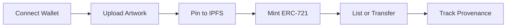
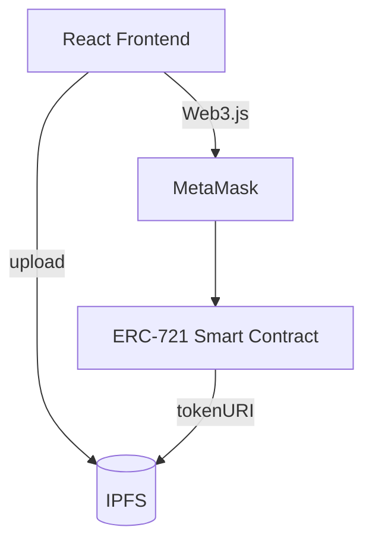

<div align="center">


# NFTMarket GH

**Mint, showcase, and trade African art on the blockchain.**

A decentralized NFT marketplace built for Ghanaian artists.

<br />

[](LICENSE)
[](https://soliditylang.org/)
[](https://reactjs.org/)
[](https://ipfs.tech/)
[](CONTRIBUTING.md)

[Features](#features) •
[Quick Start](#quick-start) •
[How It Works](#how-it-works) •
[Architecture](#architecture) •
[Roadmap](#roadmap) •
[Contributing](#contributing)

</div>

---

## Overview

NFTMarket GH gives Ghanaian artists a transparent, trustless way to tokenize and sell their work. Artists keep ownership, every sale is recorded on-chain, and artwork lives on IPFS rather than a single company's server.

## Features

| | Feature | Description |
|---|---|---|
| 🖼️ | **ERC-721 Minting** | Turn any artwork into a unique, standards-compliant token |
| 📦 | **Decentralized Storage** | Assets are pinned to IPFS, so they're permanent and censorship-resistant |
| 📜 | **Provenance Tracking** | Full ownership history is verifiable on-chain |
| 🔗 | **Wallet Integration** | Connect with MetaMask and interact through Web3.js |
| ⚛️ | **Responsive UI** | Browse, mint, and trade from a clean React frontend |

## Quick Start

### Prerequisites


- [Node.js](https://nodejs.org/) 16 or later
- [Truffle](https://trufflesuite.com/): `npm install -g truffle`
- [MetaMask](https://metamask.io/) browser extension
- Testnet ETH from a [Sepolia faucet](https://sepoliafaucet.com/)

> [!WARNING]
> The Rinkeby testnet was shut down in 2022. Point `truffle-config.js` at **Sepolia** (or another live testnet) before deploying.

### Install and run

```bash
# Clone
git clone https://github.com/KelvCodes/NFTMarketGH.git
cd NFTMarketGH

# Install dependencies
npm install

# Deploy contracts
truffle migrate --network sepolia

# Start the app
npm start
```

Open **http://localhost:3000**, connect your wallet, and mint your first NFT.

## How It Works



1. **Connect** your MetaMask wallet to the testnet.
2. **Upload** your artwork. It's pinned to IPFS automatically.
3. **Mint** an ERC-721 token linked to the IPFS hash.
4. **Trade** by listing the token for sale or transferring it directly.
5. **Track** the complete ownership history on-chain.

## Architecture



<details>
<summary><b>Project structure</b></summary>

```text
NFTMarketGH/
├── contracts/          # Solidity smart contracts
├── migrations/         # Truffle deployment scripts
├── src/
│   ├── components/     # React UI components
│   ├── utils/          # Web3 helpers
│   └── App.js
├── test/               # Contract tests
└── truffle-config.js
```

</details>

## Tech Stack

| Layer | Technology |
|---|---|
| Smart contracts |  |
| Blockchain |  |
| Frontend |  |
| Storage |  |
| Web3 |  |
| Tooling |   |

## Roadmap

- [x] ERC-721 minting
- [x] IPFS storage
- [x] On-chain provenance
- [ ] Marketplace listings and offers
- [ ] Creator royalties (EIP-2981)
- [ ] Migrate to Hardhat or Foundry
- [ ] Mobile money on-ramp for local buyers

## Contributing

Contributions are welcome. For major changes, please open an issue first.

```bash
git checkout -b feature/your-feature
git commit -m "Add your feature"
git push origin feature/your-feature
```

Then open a Pull Request.

## License

Released under the [MIT License](LICENSE).

<div align="center">

<br />

Built with 🖤 in Ghana 🇬🇭 to empower local artists.

[](https://github.com/KelvCodes)

⭐ **Star this repo if you believe in African creators on-chain.**

</div>
