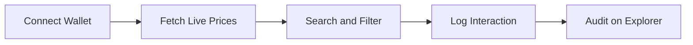
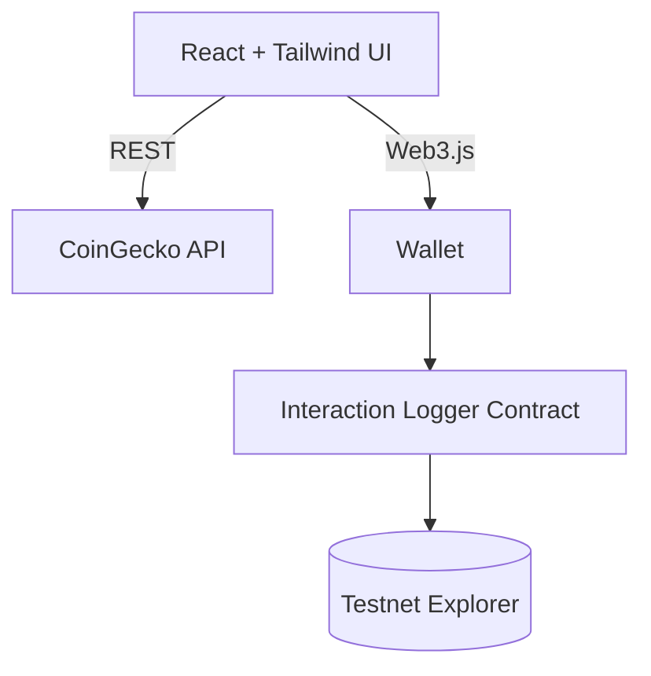

o price tracker for enthusiasts, traders, and auditors. It pulls real-time market data from CoinGecko, connects to your Web3 wallet, and can log your interactions to a smart contract on an Ethereum testnet so anyone can verify them.

## Features

| | Feature | Description |
|---|---|---|
| 📈 | **Live Prices** | Real-time market data from the CoinGecko API |
| 🔗 | **On-Chain Logging** | Interactions are recorded by a Solidity contract on an Ethereum testnet |
| 🦊 | **Wallet Connect** | Works with MetaMask and other Web3 wallets |
| 🎨 | **Modern UI** | Responsive React and Tailwind CSS interface |
| 🇬🇭 | **Ghana-First** | Built with the local crypto community in mind |

## Quick Start

### Prerequisites


- [Node.js](https://nodejs.org/) 16 or later
- [MetaMask](https://metamask.io/) or any Web3 wallet
- A [CoinGecko API key](https://www.coingecko.com/en/api) for reliable rate limits

### Install and run

```bash
# Clone
git clone https://github.com/KelvCodes/CryptoHubGhana.git
cd CryptoHubGhana

# Install dependencies
npm install

# Set up environment variables
cp .env.example .env

# Start the app
npm start
```

Open **http://localhost:3000**, connect your wallet, and start tracking.

> [!NOTE]
> Fill in your `.env` before starting. See [Configuration](#configuration).

## How It Works



1. **Connect** your wallet to an Ethereum testnet.
2. **Browse** live prices pulled from CoinGecko.
3. **Explore** by searching and filtering your favourite coins.
4. **Log** interactions on-chain, optionally.
5. **Audit** the history on the testnet block explorer.

## Architecture



<details>
<summary><b>Project structure</b></summary>

```text
CryptoHubGhana/
├── contracts/          # Solidity interaction logger
├── migrations/         # Truffle deployment scripts
├── src/
│   ├── components/     # React UI components
│   ├── hooks/          # Price fetching and Web3 hooks
│   ├── utils/          # API helpers and Web3 utilities
│   └── App.js
├── test/               # Contract tests
├── .env.example        # Environment variable template
└── truffle-config.js
```

</details>

## Configuration

Create a `.env` file in the project root:

```env
REACT_APP_COINGECKO_API_KEY=your_api_key_here
REACT_APP_RPC_URL=https://your-testnet-rpc-url
REACT_APP_CONTRACT_ADDRESS=0xYourDeployedContractAddress
```

| Variable | Description |
|---|---|
| `REACT_APP_COINGECKO_API_KEY` | Your CoinGecko API key |
| `REACT_APP_RPC_URL` | RPC endpoint for the testnet (e.g. Sepolia) |
| `REACT_APP_CONTRACT_ADDRESS` | Address of your deployed logger contract |

> [!CAUTION]
> Never commit your `.env` file. Make sure it is listed in `.gitignore`. Anything prefixed `REACT_APP_` is bundled into the frontend and visible to users, so don't put private keys there.

## Tech Stack

| Layer | Technology |
|---|---|
| Smart contracts |  |
| Frontend |  |
| Styling |  |
| Web3 |  |
| Price data |  |
| Tooling |  |

## Roadmap

- [x] Live price tracking
- [x] Wallet connection
- [x] On-chain interaction logging
- [ ] Prices in Ghana cedis (GHS)
- [ ] Watchlists and price alerts
- [ ] Portfolio tracking
- [ ] Price charts and historical data
- [ ] Dark and light theme toggle

## Contributing

Contributions are welcome, whether it's a bug fix, a new feature, or a docs improvement. For major changes, please open an issue first.

```bash
git checkout -b feature/your-feature
git commit -m "Add your feature"
git push origin feature/your-feature
```

Then open a Pull Request.

## License

Released under the [MIT License](LICENSE).

<div align="center">

<br />

Built with 🖤 in Ghana 🇬🇭 to bring crypto transparency to everyone.

[](https://github.com/KelvCodes)

⭐ **Star this repo if you found it useful.**

</div>
